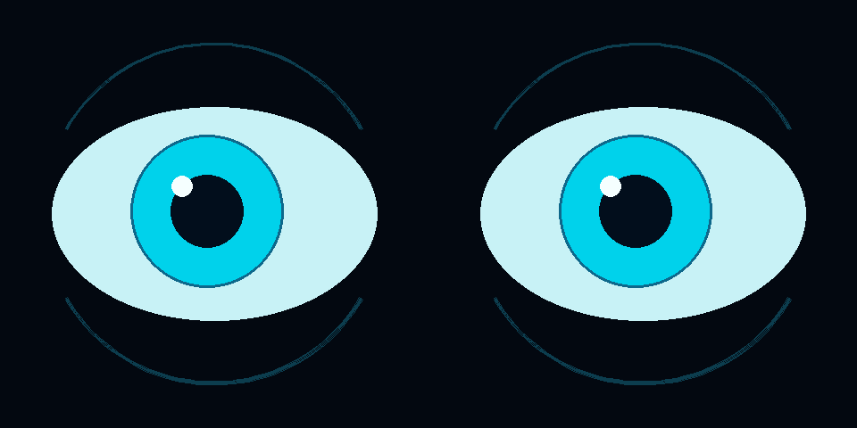

# 赛博机器人动态双眼——单 HDMI SBS 双屏

  

[English](README.md)

在**一个窗口**中渲染两只富有表情的眼睛。左侧方形区域对应屏幕 A / 左眼，右侧对应屏幕 B / 右眼。驱动板接收一路 HDMI 信号，将左右拼接（SBS）图像拆给两块屏幕。无需第二个接口，也不使用扩展桌面。两只眼睛分别绘制，支持不对称的好奇表情和轻微错开的眨眼。



## 文件结构

```text
robot-animated-eyes-dual-screen/
├── docs/
│   └── preview.png
├── tests/
│   └── test_motion.py
├── .gitignore
├── README.md
├── README_CN.md
├── config.py
├── main.py
├── requirements.txt
├── run.sh
└── setup.sh
```

## 接线与首次启动

1. 断电后，将树莓派 HDMI0 连接到双屏驱动板的唯一 HDMI 输入。Pi 4/5 的树莓派端需要 micro-HDMI，将两块面板排线按标记方向接到 A/B 输出。
2. 按规定使用稳压电源为树莓派和驱动板供电。此演示可不接 USB 触摸/数据线，HDMI 不负责面板供电。
3. 使用配套硬件配置仓库，为双 480×480 面板设置 **960×480、100% 桌面缩放**。驱动板必须支持该时序和拆分模式，整张桌面保持不旋转。
4. 在 Raspberry Pi OS Bookworm/Bullseye 或已经配置好桌面的 Debian 中，打开桌面终端：

```bash
chmod +x setup.sh run.sh
./setup.sh
# Install without launching:
./setup.sh --install-only
./run.sh
```

安装器优先使用 Debian 的 Pygame/SDL 包，并在 `--system-site-packages` 虚拟环境中引用，避免 PEP 668 全局 pip 修改和树莓派本地 wheel 编译。如果虚拟环境中不可用，则通过 `requirements.txt` 回退安装 Pygame 2.6.1；Debian 自带版本可能是较早的 2.x。请使用桌面用户运行，不要加 sudo。脚本要求可用的 Wayland/X11 桌面，不配置直接 DRM/控制台运行。

普通开发显示器或其他面板尺寸可使用：

```bash
./run.sh --windowed
./run.sh --size 720 --fps 30       # Requires a 1440×720 SBS desktop
./run.sh --windowed --mouse --expression curious
./run.sh --display 1              # Select another physical SDL output, not eye B
```

全屏模式会拒绝尺寸不等于 `2 × size` 乘 `size` 的桌面，防止图像看似正常却拆分错误。应用本身不设置 HDMI 时序。720 设置需要支持 1440×720 的双屏板；硬件指南的双屏模板只针对 480 面板。

## 操作与动画

| 按键 | 功能 |
| --- | --- |
| `N`、`H`、`A`、`C` | 平静、开心、生气、好奇 |
| 方向键 | 向左、右、上、下看，同时关闭鼠标跟随 |
| 空格 | 注视回中，同时关闭鼠标跟随 |
| `B` | 立即眨眼；自动眨眼继续工作 |
| `M` | 切换鼠标跟随 |
| Esc / `Q` | 退出 |

过渡使用经过时间与指数插值，不依赖固定帧步长。随机微眼跳使视线自然变化，眨眼使用平滑闭合曲线。鼠标坐标映射到指针所在的单块方形区域，同时驱动两只眼睛，保持一致的注视方向。`--seed N` 可复现动画，`--fps` 限制帧率。

在 `config.py` 中可修改 RGB 颜色（`PUPIL_COLOR`、`IRIS_COLOR`、`SCLERA_COLOR`）、比例参数 `EYE_WIDTH` / `EYE_HEIGHT`、`IRIS_RADIUS`、`PUPIL_DILATION`、眨眼/微眼跳间隔及 `TRANSITION_SPEED`。几何尺寸以单屏为单位归一化，明亮细节位于圆形可视区域内，虹膜会裁剪到眼睛轮廓内。程序使用 CPU Pygame 绘图和 SDL 显示，不需要厂商 GPU 包、OpenGL 绑定、素材或网络服务。

## 无桌面验证

```bash
./run.sh --headless --frames 120 --seed 7 --expression angry --screenshot /tmp/eyes.png
```

SDL dummy 驱动可在没有桌面的情况下执行有限帧模拟。PNG 能验证渲染，不能证明真实 HDMI 拆分、合成器缩放或硬件帧率。在真实桌面也可使用 `--frames N --screenshot PATH` 进行有限时长测试；dummy 模式使用固定时间步，方便复现。

## Cosplay 与 3D 打印外壳建议

分别测量面板有效圆形区域、玻璃轮廓、PCB、接口和线缆弯曲半径。设计可拆卸边框，为玻璃保留间隙并避免遮挡有效区域，打印前先用纸板模板试装。不透光塑料应位于可视半径之外，并预留线缆应力释放结构和通风孔；裸露电路应与导电涂层/紧固件隔离。将 A 装在机器人左侧、B 装在右侧，封装前验证 HDMI 映射。面板倒装时应在代码中单独旋转眼睛表面，不要旋转整个 SBS 输出。操作排线前先断电，并遵守厂商电气与温度限制。

## 常见问题

| 现象 | 处理方式 |
| --- | --- |
| 全屏尺寸报错 | 将桌面设为 960×480、100% 缩放；普通显示器使用 `--windowed`。 |
| 两块屏幕显示相同画面 | 检查驱动板固件是否处于 SBS 拆分模式，而不是硬件镜像模式。 |
| 左右眼互换或拼接处截断 | 检查 A/B 排线、画布尺寸、过扫描/缩放及整体旋转。 |
| 找不到视频设备或 Wayland 错误 | 在已登录桌面中运行，不要使用 sudo 或纯 SSH 会话启动。 |
| CPU 高或帧率低 | 尝试 `--fps 30`，关闭桌面特效和后台程序，检查树莓派是否过热降频。 |
| 无法导入 Pygame | 重新运行 `./setup.sh --install-only`，再用 `./run.sh` 选择虚拟环境。 |

## 集成边界

`EyeMotion` 管理时间驱动的行为，`render_eye` 负责绘制某一半画布。机器人控制程序可在主循环内设置 `motion.expression`、`motion.target` 或调用 `motion.blink()`。SDL 调用应留在主线程，外部事件通过有容量限制的队列传入，不要阻塞帧循环。本项目不开放远程控制端口。实际树莓派帧率和驱动板兼容性仍需硬件验证。

## 开发验证

```bash
python3 -m unittest discover -s tests -v
```

3 项标准库测试覆盖核心配置、行为或输入/API 边界。开发验证在 macOS 上完成，并非树莓派硬件实测。已检查 Shell 语法和 Python 编译，并对适用的交互演示进行渲染。APT 安装及实际树莓派启动/桌面仍需实机检查。

较旧 Bullseye 镜像可能只有 Pygame 1.x，此时安装器会安装 SDL2/编译依赖；没有可用 wheel 时将编译固定版本的 Pygame 2，请预留额外安装时间与磁盘空间。
